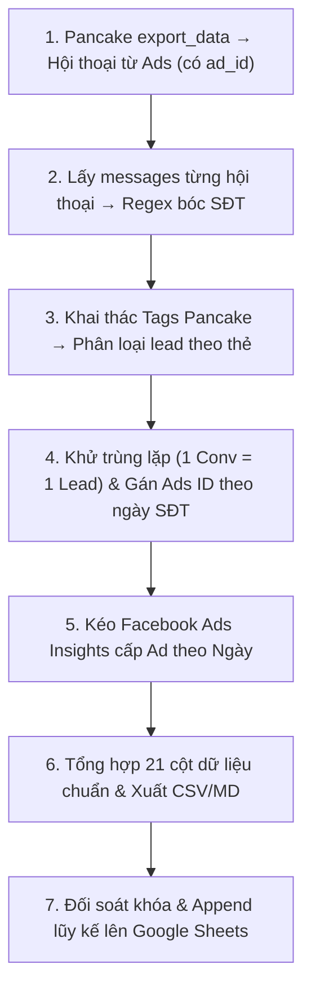

# 📈 SKILL: CẬP NHẬT BÁO CÁO FACEBOOK ADS HÀNG NGÀY & ĐỐI SOÁT LEAD PANCAKE THEO ADS ID

Tài liệu này chuẩn hóa toàn bộ quy trình thu thập số liệu Facebook Ads đa tài khoản, đọc và bóc tách dữ liệu cuộc trò chuyện từ **Pancake API** (thay thế Graph API Messenger), kết hợp **thẻ (tags)** Pancake để phân loại, đếm chính xác số lượng SĐT (1 conversation có SĐT = 1 lead), gán vào đúng **Ads ID (Lead ID)** theo ngày phát sinh và đồng bộ lên Google Sheets.

---

## 🎯 1. Nguyên Tắc & Mục Tiêu Cốt Lõi

1. **Đọc dữ liệu hội thoại qua Pancake API:**
   * Sử dụng endpoint **`GET /pages/{page_id}/export_data`** (`action=conversations_from_ads`) để lấy danh sách hội thoại phát sinh từ quảng cáo — mỗi hội thoại đã gắn sẵn `ad_id`.
   * Kết hợp endpoint **`GET /pages/{page_id}/conversations`** (lọc theo `since`/`until`) để quét toàn bộ hội thoại trong kỳ báo cáo.
   * Đọc nội dung tin nhắn từng hội thoại qua **`GET /pages/{page_id}/conversations/{conversation_id}/messages`** để bóc tách SĐT.
2. **Khai thác Thẻ (Tags) Pancake:**
   * Lấy danh sách thẻ qua **`GET /pages/{page_id}/tags`**.
   * Lọc hội thoại theo thẻ liên quan (ví dụ: tag "Có SĐT", "Lead xác nhận") để ưu tiên xử lý trước.
   * Thống kê số SĐT theo thẻ: mỗi thẻ có bao nhiêu lead phát sinh từ `ad_id` nào.
3. **Quy tắc tính Lead chuẩn:**
   * **Mỗi cuộc trò chuyện có SĐT được tính là đúng 1 Lead** (khử trùng lặp nếu khách nhắn số nhiều lần).
   * **Ngày phát sinh Lead:** Là ngày khách hàng gửi tin nhắn chứa SĐT (`inserted_at` của message từ Pancake), không phải ngày bắt đầu chiến dịch.
4. **Gán Lead cho Ads ID (Ad Attribution):**
   * Endpoint `export_data` trả về trường `ad_clicks[].ad_id` — đây là **Lead ID (Ads ID)** trực tiếp của Pancake, không cần suy luận thêm.
   * Gán `+1 Lead` vào bộ khóa: `(ad_id, ngày_phát_sinh_SĐT)`.
5. **Đồng bộ Google Sheets tự động:**
   * Cập nhật chỉ số `Sđt theo campain` dưới dạng **số nguyên (integer: 0, 1, 2...)**.
   * Chỉ thêm mới các dòng ngày chưa có, **không xóa** dữ liệu cũ.

---

## 🗂️ 2. Hạ Tầng & Công Cụ Kỹ Thuật



| Thành phần | File / Endpoint | Vai trò |
|---|---|---|
| **Pancake Page Access Token** | [`.env`](file:///d:/MCP/.env) (`PANCAKE_PAGE_ACCESS_TOKEN`) | Xác thực toàn bộ Pancake API cấp trang. |
| **Pancake MCP Server** | [`mcp_config.json`](file:///d:/MCP/mcp_config.json) (`pancake`) | Kết nối `https://mcp.pancake.biz/mcp` qua header token. |
| **Pancake API Base URL** | `https://pages.fm/api/public_api/v1` | Base URL cho các endpoint cấp Page (conversations, messages, tags, export_data). |
| **FB Graph API Token** | [`.env`](file:///d:/MCP/.env) (`FB_TOKEN`) | Kéo Insights cấp Ad (`read_insights`, `ads_read`). |
| **Kịch bản Runner 1-Click** | [`scripts/run_daily_report.py`](file:///d:/MCP/scripts/run_daily_report.py) | Điều phối toàn bộ quy trình: Quét Pancake → Gán Ads ID → Kéo Insights → Sync Sheet. |
| **Kịch bản Bóc tách & Báo cáo** | [`scripts/generate_multiacct_report.py`](file:///d:/MCP/scripts/generate_multiacct_report.py) | Quét hội thoại Pancake, tính Lead theo ngày, kết hợp số liệu 10 tài khoản Ads, xuất CSV. |
| **Kịch bản Đồng bộ Google Sheet** | [`scripts/update_google_sheet.py`](file:///d:/MCP/scripts/update_google_sheet.py) | Đối soát khóa và append dữ liệu mới lên Google Sheets. |
| **Service Account** | [`google_service_account.json`](file:///d:/MCP/google_service_account.json) | Xác thực ghi dữ liệu vào Google Sheets. |
| **File Google Sheets đích** | [Spreadsheet META ADS REPORT](https://docs.google.com/spreadsheets/d/1PD3zhqZ2rTZlMi7X3lsCh6fkvNcR-B2kGv0m9L0Fl_4/edit) | Lưu trữ báo cáo đa tab. |

---

## ⚙️ 3. Quy Trình 5 Bước Vận Hành Chi Tiết

### 🔹 Bước 1: Lấy Hội Thoại Từ Quảng Cáo Qua Pancake

**Endpoint chính — Export conversations from ads:**
```http
GET https://pages.fm/api/public_api/v1/pages/{page_id}/export_data
    ?page_access_token={PANCAKE_PAGE_ACCESS_TOKEN}
    &action=conversations_from_ads
    &since={unix_timestamp_start}
    &until={unix_timestamp_end}
    &offset=0
```
> ⚠️ Mỗi request trả về tối đa **60 hội thoại**. Tăng `offset` lên bội số 60 để phân trang đến khi hết dữ liệu.

**Dữ liệu trả về quan trọng:**

| Trường | Mô tả |
|---|---|
| `id` | Conversation ID |
| `ad_clicks[].ad_id` | **Lead ID = Ads ID** — quảng cáo dẫn khách vào hội thoại |
| `inserted_at` | Thời điểm hội thoại tạo (Unix timestamp ms) |
| `tags[].id` | Danh sách tag ID gán cho hội thoại |

**Lưu ý nghiệp vụ:**
- Một hội thoại có thể có nhiều `ad_clicks` (khách click nhiều lần). **Lấy `ad_id` đầu tiên** (lần click gần nhất dẫn vào trang) làm Lead ID.
- Nếu `ad_clicks` rỗng: hội thoại không từ quảng cáo — **bỏ qua**.

**Code mẫu Python:**
```python
import requests, os, time

PANCAKE_TOKEN = os.getenv("PANCAKE_PAGE_ACCESS_TOKEN")
BASE_URL = "https://pages.fm/api/public_api/v1"

def fetch_ad_conversations(page_id, since_ts, until_ts):
    """Lấy toàn bộ hội thoại từ quảng cáo trong kỳ, phân trang tự động."""
    conversations = []
    offset = 0
    while True:
        resp = requests.get(
            f"{BASE_URL}/pages/{page_id}/export_data",
            params={
                "page_access_token": PANCAKE_TOKEN,
                "action": "conversations_from_ads",
                "since": since_ts,
                "until": until_ts,
                "offset": offset,
            },
            timeout=30,
        )
        resp.raise_for_status()
        data = resp.json().get("conversations", [])
        if not data:
            break
        conversations.extend(data)
        offset += 60
        time.sleep(0.3)  # Tránh rate-limit
    return conversations
```

---

### 🔹 Bước 2: Lấy Tags & Lọc Hội Thoại Theo Thẻ

**Lấy danh sách thẻ của Page:**
```http
GET https://pages.fm/api/public_api/v1/pages/{page_id}/tags
    ?page_access_token={PANCAKE_PAGE_ACCESS_TOKEN}
```
Trả về danh sách tags với `id`, `name`, `color`.

**Ứng dụng thẻ trong báo cáo:**
- Map `tag_id → tag_name` để phân nhóm hội thoại.
- Thống kê số lượng lead (hội thoại có SĐT) theo từng thẻ × `ad_id`.
- Ví dụ: Tag `"Đã có SĐT"` → đếm lead xác nhận chất lượng cao.

**Code mẫu Python:**
```python
def fetch_tags(page_id):
    resp = requests.get(
        f"{BASE_URL}/pages/{page_id}/tags",
        params={"page_access_token": PANCAKE_TOKEN},
        timeout=30,
    )
    resp.raise_for_status()
    tags = resp.json().get("tags", [])
    return {t["id"]: t["name"] for t in tags}
```

---

### 🔹 Bước 3: Đọc Messages & Bóc Tách SĐT

**Lấy tin nhắn từng hội thoại:**
```http
GET https://pages.fm/api/public_api/v1/pages/{page_id}/conversations/{conversation_id}/messages
    ?page_access_token={PANCAKE_PAGE_ACCESS_TOKEN}
    &current_count=0
```
> Mỗi lần trả về **30 tin nhắn**. Tăng `current_count` để lấy thêm nếu cần.

**Quy tắc bóc tách SĐT:**
```python
import re

PHONE_REGEX = re.compile(r'(?:0|\+84)[3|5|7|8|9][0-9]{8}\b')

def extract_phone_from_conversation(page_id, conv_id, page_psid):
    """
    Trả về (phone, date_str) nếu tìm thấy SĐT từ phía khách.
    - Bỏ qua tin nhắn do Page gửi (from.id == page_psid hoặc from.type == 'page').
    - Lấy SĐT ĐẦU TIÊN tìm thấy, dừng quét.
    - date_str = ngày khách gửi SĐT (định dạng YYYY-MM-DD, múi giờ UTC+7).
    """
    current_count = 0
    while True:
        resp = requests.get(
            f"{BASE_URL}/pages/{page_id}/conversations/{conv_id}/messages",
            params={
                "page_access_token": PANCAKE_TOKEN,
                "current_count": current_count,
            },
            timeout=30,
        )
        resp.raise_for_status()
        messages = resp.json().get("messages", [])
        if not messages:
            break
        for msg in messages:
            # Bỏ qua tin nhắn của Page/Bot
            sender = msg.get("from", {})
            if str(sender.get("id")) == str(page_psid) or sender.get("type") == "page":
                continue
            text = msg.get("message", "") or ""
            match = PHONE_REGEX.search(text)
            if match:
                phone = match.group()
                # inserted_at là Unix timestamp milliseconds (UTC+0)
                ts_ms = msg.get("inserted_at", 0)
                date_str = datetime.utcfromtimestamp(ts_ms / 1000 + 7 * 3600).strftime("%Y-%m-%d")
                return phone, date_str
        current_count += 30
        time.sleep(0.2)
    return None, None
```

---

### 🔹 Bước 4: Thống Kê SĐT Theo Lead ID (Ads ID) & Tag

**Thuật toán tổng hợp:**
```python
from collections import defaultdict

def build_lead_stats(page_id, conversations, tag_map):
    """
    Trả về dict: {(ad_id, date_str): {"phone_count": int, "phones": set, "tags": set}}
    """
    stats = defaultdict(lambda: {"phone_count": 0, "phones": set(), "tags": set()})
    seen_conv = set()  # Khử trùng lặp theo conversation_id

    for conv in conversations:
        conv_id = conv["id"]
        if conv_id in seen_conv:
            continue

        # Lấy ad_id từ ad_clicks (lấy click đầu tiên)
        ad_clicks = conv.get("ad_clicks", [])
        if not ad_clicks:
            continue
        ad_id = ad_clicks[0].get("ad_id")
        if not ad_id:
            continue

        # Bóc tách SĐT từ messages
        page_psid = conv.get("page_id")  # ID của Page
        phone, date_str = extract_phone_from_conversation(page_id, conv_id, page_psid)
        if not phone:
            continue  # Hội thoại không có SĐT → không tính lead

        # Lấy tags của hội thoại
        conv_tag_ids = {t["id"] for t in conv.get("tags", [])}
        conv_tag_names = {tag_map.get(tid, tid) for tid in conv_tag_ids}

        key = (ad_id, date_str)
        stats[key]["phone_count"] += 1
        stats[key]["phones"].add(phone)
        stats[key]["tags"].update(conv_tag_names)
        seen_conv.add(conv_id)

    return stats
```

**Kết quả thống kê dạng bảng:**

| ad_id | Ngày | Số SĐT (lead) | Tags phân loại |
|---|---|---|---|
| `120215...001` | `2026-10-13` | `3` | Đã có SĐT, Tư vấn |
| `120215...002` | `2026-10-13` | `1` | Mới |
| `120215...001` | `2026-10-14` | `2` | Đã có SĐT |

---

### 🔹 Bước 5: Thu Thập Insights Facebook Ads & Tổng Hợp

1. Gửi request Insights cấp Ad cho toàn bộ 10 tài khoản qua Graph API:
   ```http
   GET /v19.0/{ad_account_id}/insights
       ?level=ad
       &time_range={"since":"YYYY-MM-01","until":"YYYY-MM-DD"}
       &time_increment=1
       &fields=date_start,campaign_id,campaign_name,ad_id,ad_name,spend,impressions,inline_link_clicks,ctr,cpc,cpm,actions
   ```
2. **Merge dữ liệu:** Khớp `(ad_id, date_start)` từ Insights với `(ad_id, date_str)` từ thống kê Pancake để điền cột `Sđt theo campain`.
3. Chuẩn hóa **21 cột dữ liệu**:
   * `Tài khoản`, `ID tài khoản`, `Ngày`, `Campaign ID`, `Tên chiến dịch`, `Trạng thái`, `Ngân sách/ngày`
   * `Chi tiêu`, `Hiển thị`, `Click link`, `CTR (%)`, `CPC`, `CPM`
   * `Tin nhắn`: `messaging_conversation_started_7d`.
   * `Lead`: Lead hệ thống Facebook.
   * `Đăng ký`: `complete_registration`.
   * `CPA`: Chi tiêu / (Tin nhắn + Lead + Đăng ký).
   * `Cập nhật lúc`, `ID quảng cáo`, `Tên quảng cáo`.
   * **`Sđt theo campain`**: Số lượng SĐT bóc tách từ Pancake, gán đúng theo `ad_id` và ngày phát sinh **(số nguyên: 0, 1, 2...)**.
   * **`Tags`**: Tên các thẻ Pancake tổng hợp cho `ad_id` trong ngày (phục vụ phân tích thêm).
4. Xuất [**`data/bao_cao_cac_tai_khoan_10_2026.csv`**](file:///d:/MCP/data/bao_cao_cac_tai_khoan_10_2026.csv) (UTF-8 BOM).
5. Xuất [**`Bao_Cao_FB/Bao_Cao_Tong_Hop_Cac_Tai_Khoan_10_2026.md`**](file:///d:/MCP/Bao_Cao_FB/Bao_Cao_Tong_Hop_Cac_Tai_Khoan_10_2026.md).

---

### 🔹 Bước 6: Đồng Bộ Lũy Kế Lên Google Sheets (Bảo Toàn Dữ Liệu Cũ)

1. Mở file [META ADS REPORT](https://docs.google.com/spreadsheets/d/1PD3zhqZ2rTZlMi7X3lsCh6fkvNcR-B2kGv0m9L0Fl_4/edit) qua Service Account.
2. **Quy tắc bảo toàn dữ liệu cũ (KHÔNG XÓA):**
   * Tuyệt đối **không gọi `clear()`**, giữ nguyên toàn bộ lịch sử.
   * Đọc danh sách khóa hiện có: `(Account ID, Ngày, Campaign ID, ID quảng cáo)`.
   * **Chỉ `append_rows`** những dòng của ngày chưa có trên Sheet.
3. Đảm bảo cột số (`Chi tiêu`, `Tin nhắn`, `Lead`, `Sđt theo campain`, `CPA`) là số thực/số nguyên.

---

## 🔑 4. Cấu Hình Xác Thực Pancake

### Qua MCP Server (khuyên dùng khi hỏi AI)
Đã cấu hình tại [`mcp_config.json`](file:///d:/MCP/mcp_config.json):
```json
"pancake": {
    "serverUrl": "https://mcp.pancake.biz/mcp",
    "headers": {
        "X-Pancake-Page-Access-Token": "<PANCAKE_PAGE_ACCESS_TOKEN>"
    }
}
```

### Qua REST API trực tiếp (dùng trong Python scripts)
```python
import os
PANCAKE_TOKEN = os.getenv("PANCAKE_PAGE_ACCESS_TOKEN")
headers = {}  # Token truyền qua query param, không qua header khi dùng REST trực tiếp

# Ví dụ gọi API
resp = requests.get(
    f"https://pages.fm/api/public_api/v1/pages/{PAGE_ID}/export_data",
    params={
        "page_access_token": PANCAKE_TOKEN,
        "action": "conversations_from_ads",
        "since": since_ts,
        "until": until_ts,
    }
)
```

---

## 🚀 5. Hướng Dẫn Kích Hoạt Báo Cáo Hàng Ngày

Chỉ cần chạy duy nhất 1 lệnh:

```powershell
python scripts/run_daily_report.py
```

Lệnh này sẽ tự động:
1. Gọi Pancake `export_data` lấy hội thoại từ quảng cáo (có sẵn `ad_id`).
2. Lấy tags Pancake, lọc & phân loại hội thoại theo thẻ.
3. Đọc messages từng hội thoại, bóc tách SĐT và gán Lead vào `(ad_id, ngày phát sinh)`.
4. Kéo dữ liệu Facebook Ads Insights của 10 tài khoản.
5. Merge SĐT từ Pancake vào cột `Sđt theo campain` theo khóa `(ad_id, ngày)`.
6. Cập nhật lũy kế lên Google Sheets (giữ nguyên dữ liệu cũ, chỉ thêm ngày chưa có).

---

## 🛡️ 6. Tiêu Chuẩn Kiểm Thử & Đối Soát (Validation Checklist)

- [ ] Mỗi hội thoại khách có SĐT chỉ được tính duy nhất **1 Lead** (theo `conversation_id`).
- [ ] SĐT ghi nhận vào đúng **Ngày khách gửi SĐT** (`inserted_at` từ Pancake, quy đổi UTC+7).
- [ ] Hội thoại **không có `ad_clicks`** hoặc `ad_id` rỗng → **không tính**, không gây lỗi.
- [ ] Hội thoại **không có SĐT** trong messages → **không tính lead**, `Sđt theo campain = 0`.
- [ ] Cột `Sđt theo campain` trên Sheet là số nguyên (`0`, `1`, `2`...), không bao giờ là chuỗi text.
- [ ] Số liệu Pancake (`ad_id`, ngày) khớp với Insights Facebook Ads cùng kỳ.
- [ ] Thẻ (tags) phản ánh đúng phân loại thực tế trên giao diện Pancake.
- [ ] Số dòng trên tab `Master Data` khớp 100% tổng các tab tài khoản con.
